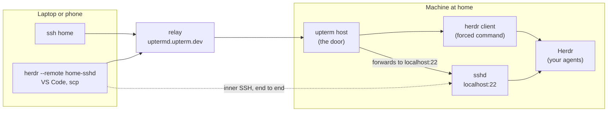

# Reach your Herdr agents from anywhere

Leave your agents running in [Herdr](https://github.com/herdrdev/herdr) on the
machine at home, and check on them, approve or steer them from a phone or
another laptop. upterm is the door: it gives the machine an address you can
reach from anywhere, without opening a port. Herdr keeps the agents, so losing
the door costs a rejoin, not the work.

You need upterm v0.37.0 or later and Herdr 0.9.0 or later, with the machine at
home on macOS or Linux.

There are two ways in:

- **`ssh home`** lands you straight in Herdr, from a laptop or a phone. It
  needs nothing on the machine but the door.
- **`ssh home-sshd`** jumps through the door to the machine's own SSH server,
  for tools that need a real one: `herdr --remote`, Herdr's saved machines, VS
  Code and scp. [Set it up](#herdr---remote-vs-code-and-scp-jump-to-the-machines-sshd)
  once the first way works.



Both ways go through the relay to the door. `ssh home` stops there: the door
runs a Herdr client for you. `ssh home-sshd` carries a second SSH connection
inside the first, which the door hands to the machine's sshd.

## Pin the relay

On the machine at home and on each laptop you connect from, pin the relay's
host certificate once, so neither trusts whatever key answers first (see
[Running Without a Terminal](../README.md#running-without-a-terminal) for the
fingerprint to check):

```console
mkdir -p ~/.ssh
cat >> ~/.ssh/known_hosts <<'EOF'
@cert-authority uptermd.upterm.dev ssh-ed25519 AAAAC3NzaC1lZDI1NTE5AAAAICiecex8Dq718eSe1CCLgLvDmI7AagvCtax7brPFWkh4
EOF
```

## Open the door

On the machine running Herdr:

```console
upterm host --detach --name home --accept \
  --authorized-user github:YOUR_GITHUB_USER \
  --force-command 'env -u HERDR_ENV herdr'
```

- **Who can join:** only the keys on your GitHub account, as they are when the
  door starts. After you add, change or revoke a key on GitHub, restart the
  door. Without `--authorized-user`, anyone with the session ID can join.
- **What a guest gets:** a Herdr client of its own. At 64 columns or fewer
  (a phone), that's Herdr's mobile layout. Clients on the same tab share its
  panes, sized for whichever client last interacted with the tab, so the agent
  repaints when you switch from laptop to phone.
- **`env -u HERDR_ENV`:** Herdr refuses to start "nested" when it sees
  `HERDR_ENV`, which every Herdr pane sets and the door passes on. It matters
  only if you start the door from a Herdr pane; elsewhere it does nothing.
- **A named Herdr session:** bare `herdr` attaches to the default session. For
  another, make the command `env -u HERDR_ENV herdr session attach NAME`.
- **Copy:** copying inside Herdr goes to the guest's clipboard over OSC 52
  (upterm sets `SSH_TTY`, so Herdr leaves the home machine's clipboard alone).
  The guest's terminal has to allow OSC 52 writes.
- **The door's lifetime:** the session's own command is your shell. Nobody
  sees it, but the door lasts as long as it does, so don't
  `upterm attach home` and type `exit`. Look with `upterm session info home`,
  and close with `upterm session stop home`.

`upterm session info home` prints the connect command. Its session ID survives
network drops and relay deploys, and changes only when you restart the door.

## Keep the machine awake

A sleeping machine can't answer the door, and its agents stop until it wakes.

On macOS, on AC power, keep the Mac from idling to sleep while the door runs
(this needs `jq`: `brew install jq`):

```console
caffeinate -is -w "$(upterm session info home -o json | jq .pid)" & disown
```

Closing the lid still forces sleep: leave a laptop's lid open, or use
clamshell mode with power and an external display. On a Linux desktop that
suspends when idle, turn that off in its power settings.

## Connect from a laptop

Pin the relay on the laptop too (above), then name the door in
`~/.ssh/config`, with the session ID from `upterm session info home`:

```
Host home
  HostName uptermd.upterm.dev
  User SESSION_ID
```

The key ssh offers has to be on your GitHub account; if it isn't one ssh
offers by default, add `IdentityFile ~/.ssh/YOUR_KEY` under `Host home`.

`ssh home` lands you in Herdr. `ctrl+b q` (Herdr's default) detaches: your
agents and the door keep running, and `ssh home` takes you back.

## Connect from a phone

In Termius or Blink, add a host with:

- **Host:** `uptermd.upterm.dev`, port 22;
- **Username:** the session ID;
- **Key:** one on your GitHub account.

The first time, the app asks you to trust the relay's key. Accept it only if
its fingerprint is `SHA256:9ajV8JqMe6jJE/s3TYjb/9xw7T0pfJ2+gADiBIJWDPE`, the
one [Running Without a Terminal](../README.md#running-without-a-terminal)
publishes.

## `herdr --remote`, VS Code and scp: jump to the machine's sshd

These need a real SSH server. If the machine at home runs one, you can jump to
it through the door. The inner connection is end to end between you and that
sshd; the relay forwards only ciphertext.

1. **Turn on the machine's sshd** (on macOS, System Settings → General →
   Sharing → Remote Login), and add your key to your account's
   `~/.ssh/authorized_keys` there.
2. **Let the door forward.** Start it with `--allow-local-tcp-forwarding`
   added to the command above. If the door is already running, stop it first
   (`upterm session stop home`). The new door has a new session ID, so update
   `User` under `Host home`, and on a Mac, start `caffeinate` again.
3. **Name the jump** in the laptop's `~/.ssh/config`, below `Host home`:

   ```
   Host home-sshd
     HostName localhost
     User YOUR_USER_ON_THE_MACHINE
     HostKeyAlias home-sshd
     ProxyJump home
   ```

   If ssh doesn't offer the right key by default, give `home-sshd` its own
   `IdentityFile`: it doesn't inherit `home`'s.
4. **Record the machine's host key.** Herdr connects with
   `StrictHostKeyChecking=yes`, so an unknown key fails instead of prompting.
   Run `ssh home-sshd` once, and before you accept the key, check its
   fingerprint against the line of the same type from
   `ssh-keyscan localhost | ssh-keygen -lf -`, run on the machine.

Now these work from the laptop:

- `herdr --remote home-sshd` (add `--session NAME` for a named session);
- `scp file home-sshd:`;
- VS Code's "Remote-SSH: Connect to Host…" → `home-sshd`;
- a saved machine: `herdr machine add home-sshd --label Home` (add
  `--remote-session NAME` for a named session), then choose Home in Herdr's
  sidebar. Saved machines can't ask for a passphrase, so load a
  passphrase-protected key into your agent first (`ssh-add`).

Run `herdr --remote` from an ordinary terminal, not from a Herdr pane: the
pane's `HERDR_ENV` trips the same nested guard, and its `HERDR_SESSION` can
pick a remote session you didn't mean.

`upterm session info home` lists each jump as `jump … → localhost:22`. If
ssh or Herdr reports `Connection closed by UNKNOWN port 65535`, the jump
failed; `ssh -v home-sshd` shows why. The usual causes: no `Host home`, a
stale session ID after a door restart, a door without
`--allow-local-tcp-forwarding`, or no sshd listening on the machine.

`--allow-local-tcp-forwarding` lets a guest reach anything the machine can,
your LAN included, so use it only with `--authorized-user`.

## Share an agent through a door, not its own terminal

`upterm host -- claude` shares Claude Code's own terminal: every guest sees
one screen at the smallest guest's size, and one who joins at a different
size can find the scrollback garbled. Through a Herdr (or tmux) door, each
guest gets a client of its own, and joining never replays the agent's
transcript.

## Sensitive work

Traffic through the public relay is decrypted there, apart from the jump to
your own sshd. For sensitive work, [run your own
relay](../README.md#hammer_and_wrench-deployment): it's one binary.
