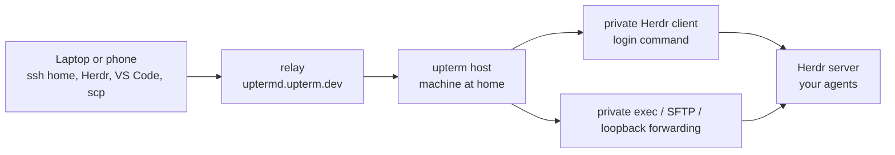

# Reach your Herdr agents from anywhere

Leave your agents running in [Herdr](https://github.com/herdrdev/herdr) on the
machine at home, and check on them, approve or steer them from a phone or
another laptop. upterm is the door: it gives the machine an address you can
reach from anywhere, without opening a port. Herdr keeps the agents, so losing
the door costs a rejoin, not the work.

Use an upterm build whose `upterm host --help` lists `--login-command`,
`--accept-exec` and `--allow-loopback-tcp-forwarding`, and Herdr 0.9.0 or
later, with the machine at home on macOS or Linux.

For ordinary terminal sharing, start `upterm host` and share its join command.
Every guest sees the same terminal. This guide instead gives each guest a
private Herdr client and lets remote tools connect directly, without sshd.
The optional [sshd jump](#optional-jump-to-the-machines-sshd) adds an inner
SSH connection encrypted through the relay.



## Pin the relay

On the machine at home and on each laptop you connect from, pin the relay's
host certificate once, so neither trusts whatever key answers first (see
[Running Without a Terminal](../README.md#running-without-a-terminal) for the
fingerprint to check):

```console
mkdir -p ~/.ssh
cat >> ~/.ssh/known_hosts <<'EOF'
@cert-authority uptermd.upterm.dev ssh-ed25519 AAAAC3NzaC1lZDI1NTE5AAAAICiecex8Dq718eSe1CCLgLvDmI7AagvCtax7brPFWkh4
EOF
```

## Open the door

On the machine running Herdr:

```console
upterm host --detach --name home --accept \
  --authorized-user github:YOUR_GITHUB_USER \
  --login-command 'env -u HERDR_ENV herdr' \
  --accept-exec \
  --allow-loopback-tcp-forwarding
```

`--login-command` selects what plain `ssh home` opens. Explicit commands from
Herdr remote mode and VS Code run separately, with `--accept-exec` granting
execution trust: a guest can send further code over stdin. `--accept` grants
SFTP and skips the startup prompt; it grants neither exec nor forwarding.
Herdr alone needs no forwarding grant. The literal loopback grant above lets
VS Code reach services on 127.0.0.0/8 or ::1 without asking; it excludes
`localhost`, other hostnames, mapped IPv6 and addresses with zones. It is not
network containment: an exec-authorized guest can open sockets as your account.

- **Who can join:** only the keys on your GitHub account, as they are when the
  door starts. After you add, change or revoke a key on GitHub, restart the
  door. Without `--authorized-user`, anyone with the session ID can join.
- **What a guest gets:** a Herdr client of its own. At 64 columns or fewer
  (a phone), that's Herdr's mobile layout. Clients on the same tab share its
  panes, sized for whichever client last interacted with the tab, so the agent
  repaints when you switch from laptop to phone.
- **`env -u HERDR_ENV`:** Herdr refuses to start "nested" when it sees
  `HERDR_ENV`, which every Herdr pane sets and the door passes on. It matters
  only if you start the door from a Herdr pane; elsewhere it does nothing.
- **A named Herdr session:** bare `herdr` attaches to the default session. For
  another, make the command `env -u HERDR_ENV herdr session attach NAME`.
- **Copy:** copying inside Herdr goes to the guest's clipboard over OSC 52
  (upterm sets `SSH_TTY`, so Herdr leaves the home machine's clipboard alone).
  The guest's terminal has to allow OSC 52 writes.
- **The door's lifetime:** the session's own command is your shell. Nobody
  sees it, but the door lasts as long as it does, so don't
  `upterm attach home` and type `exit`. Look with `upterm session info home`,
  and close with `upterm session stop home`.

`upterm session info home` prints the connect command. Its session ID survives
network drops and relay deploys, and changes only when you restart the door.

## Keep the machine awake

A sleeping machine can't answer the door, and its agents stop until it wakes.

On macOS, on AC power, keep the Mac from idling to sleep while the door runs
(this needs `jq`: `brew install jq`):

```console
caffeinate -is -w "$(upterm session info home -o json | jq .pid)" & disown
```

Closing the lid still forces sleep: leave a laptop's lid open, or use
clamshell mode with power and an external display. On a Linux desktop that
suspends when idle, turn that off in its power settings.

## Connect from a laptop

Pin the relay on the laptop too (above), then name the door in
`~/.ssh/config`, with the session ID from `upterm session info home`:

```
Host home
  HostName uptermd.upterm.dev
  User SESSION_ID
```

The key ssh offers has to be on your GitHub account; if it isn't one ssh
offers by default, add `IdentityFile ~/.ssh/YOUR_KEY` under `Host home`.

`ssh home` lands you in Herdr. `ctrl+b q` (Herdr's default) detaches: your
agents and the door keep running, and `ssh home` takes you back.

## Connect from a phone

In Termius or Blink, add a host with:

- **Host:** `uptermd.upterm.dev`, port 22;
- **Username:** the session ID;
- **Key:** one on your GitHub account.

The first time, the app asks you to trust the relay's key. Accept it only if
its fingerprint is `SHA256:9ajV8JqMe6jJE/s3TYjb/9xw7T0pfJ2+gADiBIJWDPE`, the
one [Running Without a Terminal](../README.md#running-without-a-terminal)
publishes.

## Herdr remote mode, saved machines, VS Code and scp

The same `home` alias works for all of these, directly through upterm:

- `herdr --remote home` (add `--session NAME` for a named session);
- a saved machine: `herdr machine add home --label Home` (add
  `--remote-session NAME` for a named session), then choose Home in Herdr's
  sidebar;
- VS Code's "Remote-SSH: Connect to Host…" → `home`;
- `scp file home:` or `sftp home`. Modern scp uses SFTP; it needs the existing
  file-transfer permission, not exec or forwarding. Legacy `scp -O` uses exec.

Herdr uses strict host-key checking, so pin the relay key before connecting.
Saved machines can't ask for a key passphrase: load a passphrase-protected key
into your agent first with `ssh-add`. Put `herdr` and any remote tools on the
host's non-interactive PATH, since guest exec inherits the door's environment.
Guest commands start in the directory where the door launched; relative SFTP
paths retain their home-directory base.

Run `herdr --remote` from an ordinary terminal, outside a Herdr pane: the
pane's `HERDR_ENV` trips the nested guard, and its `HERDR_SESSION` can select
a remote session you didn't mean. The login command above clears `HERDR_ENV`
for plain SSH clients.

If a tool fails, check `ssh -v home`, the key allowlist, the session ID and the
host's PATH. After restarting the door, update `User` under `Host home` and
phone entries; on a Mac, start `caffeinate` again. Flags are fixed for one run.

## Optional jump to the machine's sshd

Use this when you want an inner SSH connection encrypted end to end between
your laptop and sshd. The relay sees only its ciphertext. Direct upterm shell,
exec, SFTP and forwarding traffic is decrypted at the relay.

1. Enable the machine's sshd (on macOS: System Settings → General → Sharing →
   Remote Login), and add your key to your account's `~/.ssh/authorized_keys`.
2. Keep the loopback grant in the door command above. It covers the literal
   `127.0.0.1:22` below. The unrestricted `--allow-local-tcp-forwarding` also
   works but grants access to anything the machine can reach, including its LAN.
3. Add a separate alias below `Host home` in the laptop's `~/.ssh/config`:

   ```
   Host home-sshd
     HostName 127.0.0.1
     User YOUR_USER_ON_THE_MACHINE
     HostKeyAlias home-sshd
     ProxyJump home
   ```

   Give it its own `IdentityFile` if needed; it doesn't inherit `home`'s.
4. Run `ssh home-sshd` once to pin the machine's host key. Before accepting,
   compare its fingerprint with the same key type from
   `ssh-keyscan 127.0.0.1 | ssh-keygen -lf -`, run on the home machine.

Then use `home-sshd` instead of `home` for tools that should use this inner
connection. `upterm session info home` lists the jump and its destination.
`Connection closed by UNKNOWN port 65535` can indicate a failed jump; inspect
`ssh -v home-sshd`, the alias, session ID, forwarding grant and sshd listener.

## Share an agent through a door, not its own terminal

`upterm host -- claude` shares Claude Code's own terminal: every guest sees
one screen at the smallest guest's size, and one who joins at a different
size can find the scrollback garbled. Through a Herdr (or tmux) door, each
guest gets a client of its own, and joining never replays the agent's
transcript.

## Sensitive work

Traffic through the public relay is decrypted there, apart from the jump to
your own sshd. For sensitive work, [run your own
relay](../README.md#hammer_and_wrench-deployment): it's one binary.
