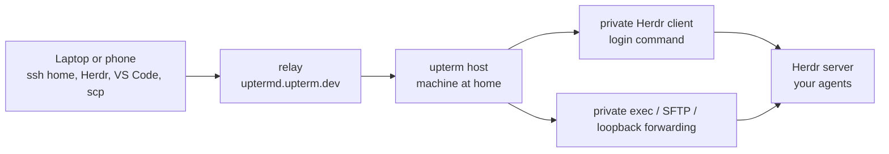

# Reach your Herdr agents from anywhere

Leave your agents running in [Herdr](https://github.com/herdrdev/herdr) on the
machine at home, and check on them, approve or steer them from a phone or
another laptop. upterm is the door: it gives the machine an address you can
reach from anywhere, without opening a port. Herdr keeps the agents, so losing
the door costs a rejoin, not the work.

Use an upterm build that has `upterm session ssh-config` (its
`upterm host --help` lists `--full-access`), and Herdr 0.9.0 or later, with the
machine at home on macOS or Linux.

For ordinary terminal sharing, start `upterm host` and share its join command.
Every guest sees the same terminal. This guide instead gives each guest a
private Herdr client and lets remote tools connect directly, without sshd.
The optional [sshd jump](#optional-jump-to-the-machines-sshd) adds an inner
SSH connection encrypted through the relay.



## Pin the relay

On the machine at home, pin the relay's host certificate once, so the door
checks the relay rather than trusting whatever key answers first (see
[Running Without a Terminal](../README.md#running-without-a-terminal) for the
fingerprint to check):

```console
mkdir -p ~/.ssh
cat >> ~/.ssh/known_hosts <<'EOF'
@cert-authority uptermd.upterm.dev ssh-ed25519 AAAAC3NzaC1lZDI1NTE5AAAAICiecex8Dq718eSe1CCLgLvDmI7AagvCtax7brPFWkh4
EOF
```

Each laptop gets the same key from the door later, from
`upterm session ssh-config home`.

## Open the door

On the machine running Herdr:

```console
upterm host --detach --name home --full-access \
  --authorized-user github:YOUR_GITHUB_USER \
  --login-command herdr
```

That is four decisions:

- **`--detach`:** run the door in the background. It asks before it starts
  the door, on this terminal, and prints the door's ssh config.
- **`--name home`:** call it `home`, for `upterm session` and for `ssh home`.
- **`--authorized-user github:YOUR_GITHUB_USER --full-access`:** let the keys
  on your GitHub account in, and give them what an SSH login to this machine
  gets, without asking you: Herdr remote mode and VS Code run commands, scp
  and sftp transfer files, and forwards reach this machine's loopback
  addresses (literal `127.0.0.0/8` and `::1`; not `localhost`). It isn't
  network containment: a guest that runs commands can open sockets as your
  account.
- **`--login-command herdr`:** plain `ssh home` opens Herdr.

More about the door:

- **Who can join:** only the keys on your GitHub account, as they are when the
  door starts. After you add, change or revoke a key on GitHub, restart the
  door. Without `--authorized-user`, anyone with the session ID could join,
  which is why `--full-access` refuses to start without it.
- **What a guest gets:** a Herdr client of its own. At 64 columns or fewer
  (a phone), that's Herdr's mobile layout. Clients on the same tab share its
  panes, sized for whichever client last interacted with the tab, so the agent
  repaints when you switch from laptop to phone.
- **Started from a Herdr pane:** the door keeps that pane's `HERDR_ENV` from
  guest commands, so Herdr's guard against starting nested doesn't trip.
- **A named Herdr session:** bare `herdr` attaches to the default session. For
  another, make the command `herdr session attach NAME`.
- **Copy:** copying inside Herdr goes to the guest's clipboard over OSC 52
  (upterm sets `SSH_TTY`, so Herdr leaves the home machine's clipboard alone).
  The guest's terminal has to allow OSC 52 writes.
- **The door's lifetime:** the session's own command is your shell. Nobody
  sees it, but the door lasts as long as it does. `upterm attach home` warns
  you as it puts you in it: `upterm: this is home's door; 'exit' closes it for
  every guest. ~. detaches; ~a reviews requests.` Leave with `~.`, not `exit`.
  Look with `upterm session info home`, and close with
  `upterm session stop home`.

`upterm session info home` shows the door. Its session ID survives network
drops and relay deploys, and changes only when you restart the door.

## Keep the machine awake

A sleeping machine can't answer the door, and its agents stop until it wakes.

On macOS, on AC power, keep the Mac from idling to sleep while the door runs
(this needs `jq`: `brew install jq`):

```console
caffeinate -is -w "$(upterm session info home -o json | jq .pid)" & disown
```

Closing the lid still forces sleep: leave a laptop's lid open, or use
clamshell mode with power and an external display. On a Linux desktop that
suspends when idle, turn that off in its power settings.

## Connect from a laptop

On the machine at home, print the door's ssh config:

```console
upterm session ssh-config home
```

It prints two parts, each under a comment naming its file, with the door's own
session ID as `User`:

```text
# ~/.ssh/config
Host home
  HostName uptermd.upterm.dev
  User d3k5fia7m4us73ehblug
# ~/.ssh/known_hosts, once per device
uptermd.upterm.dev ssh-ed25519 AAAAC3NzaC1lZDI1NTE5AAAAICiecex8Dq718eSe1CCLgLvDmI7AagvCtax7brPFWkh4
```

On the laptop, put the `Host home` block in `~/.ssh/config`, and add the
relay's line to `~/.ssh/known_hosts` once. It is the key you pinned on the
machine at home, as a line for the key itself. If the door's own
`known_hosts` didn't have the relay's key when it started, a comment above
the line says so: compare its fingerprint with the one the README publishes
before you add it.

The key ssh offers has to be on your GitHub account; if it isn't one ssh
offers by default, add `IdentityFile ~/.ssh/YOUR_KEY` under `Host home`.

`ssh home` lands you in Herdr. `ctrl+b q` (Herdr's default) detaches: your
agents and the door keep running, and `ssh home` takes you back.

## Connect from a phone

In Termius or Blink, add a host with:

- **Host:** `uptermd.upterm.dev`, port 22;
- **Username:** the `User` that `upterm session ssh-config home` prints;
- **Key:** one on your GitHub account.

The first time, the app asks you to trust the relay's key. Accept it only if
its fingerprint is `SHA256:9ajV8JqMe6jJE/s3TYjb/9xw7T0pfJ2+gADiBIJWDPE`, the
one [Running Without a Terminal](../README.md#running-without-a-terminal)
publishes.

## Herdr remote mode, saved machines, VS Code and scp

The same `home` alias works for all of these, directly through upterm:

- `herdr --remote home` (add `--session NAME` for a named session);
- a saved machine: `herdr machine add home --label Home` (add
  `--remote-session NAME` for a named session), then choose Home in Herdr's
  sidebar;
- VS Code's "Remote-SSH: Connect to Host…" → `home`;
- `scp file home:` or `sftp home`. Modern scp uses SFTP; it needs the existing
  file-transfer permission, not exec or forwarding. Legacy `scp -O` uses exec.

To reach a dev server on the machine from the laptop, say on port 3000, add a
`LocalForward` with literal loopback addresses under `Host home`, then open
`http://127.0.0.1:3000` on the laptop:

```text
  LocalForward 127.0.0.1:3000 127.0.0.1:3000
```

In testing, VS Code's own `remote.SSH.defaultForwardedPorts` setting didn't
forward through upterm: its log said "Created tunnel does not match
requirements of requested tunnel. Host or port mismatch."

Herdr uses strict host-key checking, so pin the relay key before connecting.
Saved machines can't ask for a key passphrase: load a passphrase-protected key
into your agent first with `ssh-add`. Guest commands get the PATH of the shell
that started the door, so start it where `herdr` and your remote tools are on
the PATH. Guest commands start in the directory where the door launched;
relative SFTP paths retain their home-directory base.

Run `herdr --remote` from an ordinary terminal, outside a Herdr pane: the
pane's `HERDR_ENV` trips the nested guard, and its `HERDR_SESSION` can select
a remote session you didn't mean.

If a tool fails, check `ssh -v home`, the key allowlist and the door's PATH.
After restarting the door, print its ssh config again, and replace the
`Host home` block on each laptop and the Username on the phone; on a Mac,
start `caffeinate` again. On a relay that routes by node, the `User` also
changes when the door comes back on another node: print the ssh config and
replace both then too. Flags are fixed for one run.

## Optional jump to the machine's sshd

Use this when you want an inner SSH connection encrypted end to end between
your laptop and sshd. The relay sees only its ciphertext. Direct upterm shell,
exec, SFTP and forwarding traffic is decrypted at the relay.

1. Enable the machine's sshd (on macOS: System Settings → General → Sharing →
   Remote Login), and add your key to your account's `~/.ssh/authorized_keys`.
2. The door above already allows the jump: `--full-access` includes forwards
   to the literal `127.0.0.1:22` below. If the jump is all you want, a door
   that allows only loopback forwards will do, with no commands, no file
   transfers and no login command:

   ```console
   upterm host --detach --name home --no-exec --no-sftp \
     --authorized-user github:YOUR_GITHUB_USER \
     --allow-forwarding=loopback
   ```

   Plain `ssh home` would still share that door's own terminal, which only
   your keys can reach; the jump never opens it. `--allow-forwarding=any` also
   works, but lets guests reach anything the machine can, its LAN included.
3. Add a separate alias below `Host home` in the laptop's `~/.ssh/config`:

   ```
   Host home-sshd
     HostName 127.0.0.1
     User YOUR_USER_ON_THE_MACHINE
     HostKeyAlias home-sshd
     ProxyJump home
   ```

   Give it its own `IdentityFile` if needed; it doesn't inherit `home`'s.
4. Run `ssh home-sshd` once to pin the machine's host key. Before accepting,
   compare its fingerprint with the same key type from
   `ssh-keyscan 127.0.0.1 | ssh-keygen -lf -`, run on the home machine.

Then use `home-sshd` instead of `home` for tools that should use this inner
connection. `upterm session info home` lists the jump and its destination.
`Connection closed by UNKNOWN port 65535` can indicate a failed jump; inspect
`ssh -v home-sshd`, the alias, the `Host home` block, the forwarding grant and
the sshd listener.

## Share an agent through a door, not its own terminal

`upterm host -- claude` shares Claude Code's own terminal: every guest sees
one screen at the smallest guest's size, and one who joins at a different
size can find the scrollback garbled. Through a Herdr (or tmux) door, each
guest gets a client of its own, and joining never replays the agent's
transcript.

## Sensitive work

Traffic through the public relay is decrypted there, apart from the jump to
your own sshd. For sensitive work, [run your own
relay](../README.md#hammer_and_wrench-deployment): it's one binary. Give the
door `--server` with your relay's address, and `upterm session ssh-config
home` prints the `User` your relay routes by. On a relay without Consul, which
routes by node, it is longer than the session ID, and it also changes when the
door comes back on another node.
